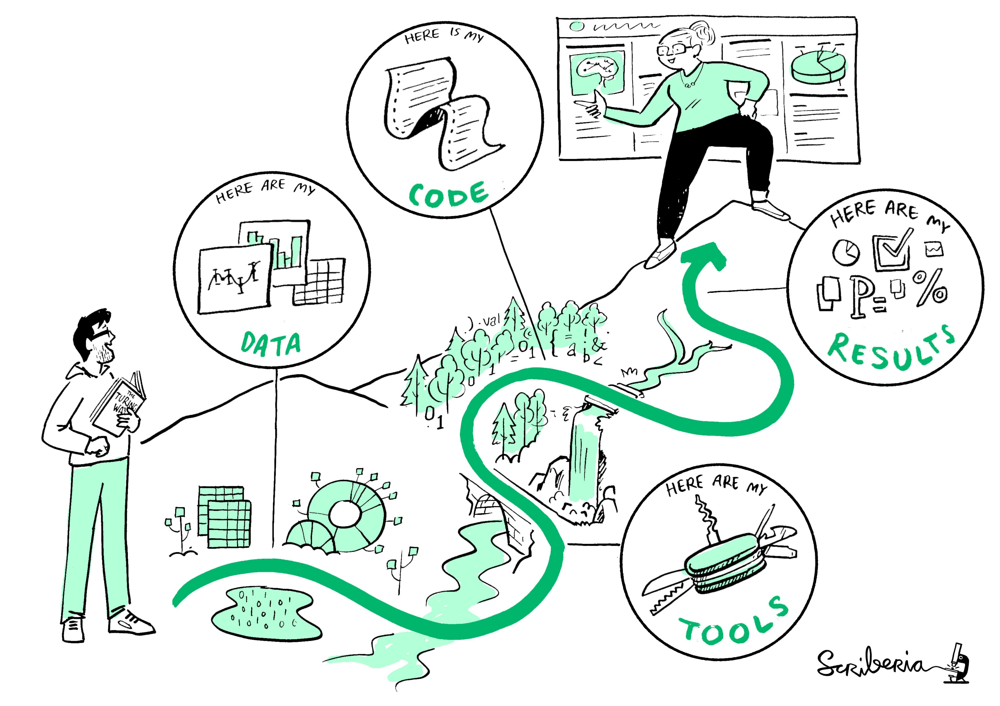
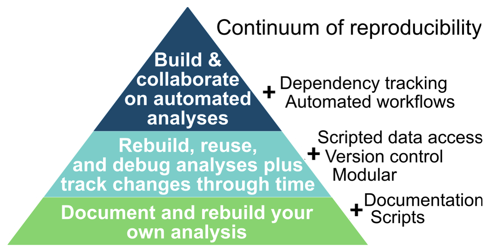
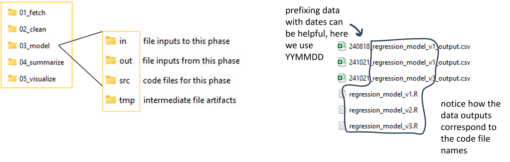
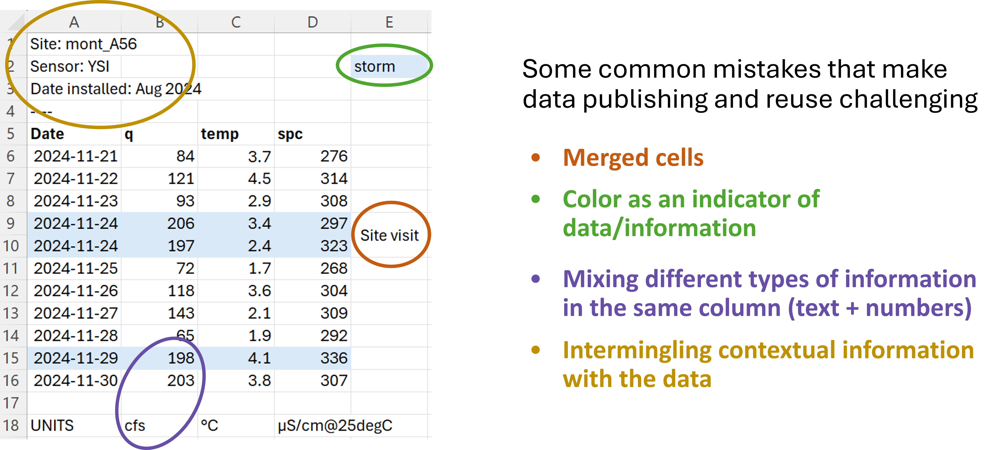

# Data Management

Imagine you finished an analysis months ago for a paper currently in review, and the associated data products are archived. Then you get a message: one of your monitoring sites had a sensor malfunction, and the provider has corrected the record. How you feel about that message depends almost entirely on how you managed your data, workflows, and documentation along the way.

_Your colleague informs you of an unfortunate scenario where you are required to reproduce your analyses that you finished months ago using corrected data._

That is what this page is about. **Data management** is the set of actions you take *during* a research project (not just at the end) so that your methods are credible and you (including your future self), and everyone else, can have confidence in your results. These practices are also what make the data publishing step in the next module possible. Tidy data, solid documentation, and complete metadata don't appear at publication time. They get built in as you go.

_An illustration demonstrating the value of documenting at each stage of the data lifecycle for improving research reproducibility ([The Turing Way Community and Scriberia, 2024](https://zenodo.org/records/13882307))._

## It's really data *and* information management

When we say "data", we mean more than the numbers in your spreadsheet. Good management covers everything around the data too:

- **The data itself:** raw data (e.g., direct output from a sensor), quality controlled data (e.g., data manually screened for outliers), and derived data (e.g., model outputs).
- **The data about the data (metadata):** data collection protocols, spatial and temporal coverage, permissions or sensitivity restrictions, and other information around how the data was generated.
- **The code:** if you wrote scripts, notebooks, or models to clean, analyze, or present the data, that code is a research product too and needs the same care.

The FAIR principles you saw earlier for data have also been adapted for research software ([Barker, 2022](https://doi.org/10.1038/s41597-022-01710-x)) and more recently for computational workflows ([Wilkinson, 2022](https://doi.org/10.1038/s41597-025-04451-9)). Treating your codebase as something others (including your future self) will need to be able to access, understand, and implement is a big part of how this page is organized. 

This page covers three things, in order: planning for your data up front with a **data management plan**, understanding what **reproducibility** is and how to build toward it, and **three simple approaches** you can start using today to make meaningful strides towards making your research reproducible.

## Data Management Plans

A **Data Management Plan (DMP; or DMSP for Data Management and Sharing Plan)** is a short document that describes what data your project will create or use and how you will handle them from start to finish ([Wong, 2026](https://www.cuahsi.org/uploads/pages/doc/DMP_guide_digital.pdf)). Think of it as a roadmap you write *before* the work starts so that decisions about file formats, storage, documentation, and sharing aren't made in a panic at the end of the project.

Many funders now require a DMP or DMSP as part of a proposal. While the specifics differ by agency and program, most ask you to address a similar set of questions outlined in the table below.

| A DMP or DMSP often provides answers to... | What that can look like in a water project |
| --- | --- |
| What data will you create or collect? | Continuous sensor records, grab samples, field notes, model output |
| What formats and standards will you use? | CSV for tabular data, community units and parameter codes, a documented file naming scheme |
| How will you document and describe the data? | A data dictionary, site metadata table, and a README |
| Where will data be stored and backed up during the project? | A project folder with a single source of truth, version-controlled code, and a backup plan |
| How will data be shared and preserved? | A data repository such as HydroShare, with a DOI |
| Who is responsible for what? | Named people for QA/QC, data release, and updates |
| Are there access, privacy, or licensing considerations? | Sensitive locations, data-sharing agreements, an open license for what *can* be shared |

_A summary table describing key elements of a Data Management Plan (DMP) or Data Management and Sharing Plan (DMSP) and what this can look like in a water project._

A few tips that make DMPs and DMSPs more useful than a box to check:

- **Treat it as a living document.** Projects change. Revisit your plan when your sensors, collaborators, or questions change.
- **Plan for the sharing step early.** Choosing a repository and a license at the *start* of a project means you can organize and document with the end in mind. [Rosenberg et al. (2020)](https://doi.org/10.1061/%28ASCE%29WR.1943-5452.0001215) recommend building reproducibility into a project from the beginning, including budgeting the time and storage it takes.
- **Use existing tools and resources to help get you started.** There are many existing materials and services dedicated to helping you get your Data Management Plan started. Many university library and research offices offer their own data management plan tools, templates, and one-on-one support.

_Click the image to open the full DMP guide (PDF). The links to templates, tools, and other resources are clickable in the PDF, but not in the image above._

## Reproducibility techniques

### What do we mean by "reproducible"?

Reproducibility is at the core of how we think science works. We trust a result because the people who produced it can show their work, and others can check it. Peer review and publication both rest on that idea. Adapting from existing definitions of reproducibility (e.g., [The Turing Way Community, 2025](https://zenodo.org/records/15213042)), we consider reproducibility to mean that **methods can be easily rebuilt using the same data to recreate results or new data to update an analysis** (Platt, 2026). Rebuildability also depends on something easy to overlook: the people most likely to need to rebuild your work includes **your future self**. If you have ever opened a project from six months ago and wondered what `final_v3_USE_THIS_ONE.xlsx` was, this message will hit home.

This understanding of reproducibility also allows for _tiers of reproducibility_, which show that reproducibility is on a continuum rather than an all-or-nothing property:

_Continuum of reproducibility, where more time and techincal skill is required as you go up each tier._

It all starts with documentation and capturing data transformations in scripts. As projects become more data-intensive and our skills grow more technical, the next step is often to track code changes with a version control tool like Git (hosted on platforms like [GitHub](https://github.com/)) and commit modular code and functions across the codebase. Eventually, we may adopt automation and dependency-tracking tools (e.g., [`targets`](https://docs.ropensci.org/targets/) or [`Snakemake`](https://snakemake.readthedocs.io/en/stable/)) to build full data pipelines that reliably and efficiently execute workflows in encapsulated, pre-configured environments.

The barriers to reproducible research are real and non-trivial: added time, extra effort, and potential lack of recognition ([Gomes, 2022](https://doi.org/10.1098/rspb.2022.1113); [Whitaker, 2019](https://doi.org/10.5281/zenodo.2669547)). Still, the payoff is worth it: reproducibility is an investment in yourself and your work, and the journey can begin in a meaningful way **today**.

## Improving data management with three simple approaches

Thankfully, you don't need to consider yourself as a programmer, or to adopt every tool mentioned above, to make real progress on reproducibility. The three approaches described in this section target the first tier of the continuum: documentation and well-organized, well-structured files. Each one takes some thought and a little time, not advanced technical skill, and each pays off both for you and for anyone who later reuses your work (including your future self).

### 1. Project organization

Good organization makes it easier for you and others to find files and products later. The goal is to be intentional: even if you land on a different pattern than the one below, spend some time thinking through how your project is structured and how your files are named.

**Define an ordered folder structure.** Think about your project in terms of steps or phases, and create a numbered folder for each so it is clear what order they run in and what happens in each one. Inside each phase folder, use consistent subfolders to keep code, input data, output data, and intermediate files separated.

**Converge on file naming conventions.** A good naming convention lets you understand a file without opening it. One approach is to prefix input and output files with a date (e.g., `YYMMDD`) so you can track when a file was generated from the filename alone. Matching output file names to the code that produced them (e.g., `regression_model_v1.R` creates `regression_model_v1_output.csv`) makes it easy to trace a result back to its source.

_An example folder structure organized by numbered project phases (left), where each phase contains subfolders for inputs (`in`), outputs (`out`), code (`src`), and intermediate files (`tmp`) (right). Example file names within the folders using a `YYMMDD` date prefix and matching code and output names, so that each output can be traced back to the script that created it._

### 2. Machine-readable data

Spreadsheet software like Excel is intuitive and keeps your data right at your fingertips. But it also gives you a lot of freedom to customize how your data look, which can make the data difficult for others to publish or reuse. **Machine-readable** data are structured so that code can easily load them into a usable state. Here are some commonly used spreadsheet features to avoid that work against that:

- **Merged cells:** these break the one-value-per-cell structure that code expects.
- **Color as the only indicator of information:** a color (e.g., blue to flag a data point collected during a storm) is lost as soon as the file is read by code or converted to a plain-text format.
- **Mixing data types in the same column:** combining text and numbers (e.g., `12.4 cfs`) means the column is read as text rather than as numbers.
- **Including metadata in the same sheet as the data:** notes, site descriptions, and other context above or beside your data make it hard to tell where the data actually start.

_An example spreadsheet with several common practices that make data publishing and reuse challenging: merged cells (indicating a site visit), color as the indicator of information (blue means the data point occurred during a storm), units in the same column as the values, and metadata above the data._

A more reusable approach is to store the data in a tidy, rectangular table where every column holds one type of information and every row is one observation. Information that was previously encoded by color gets its own column (e.g., `storm_day` as a TRUE/FALSE value), and the site metadata move to a separate sheet or file. You can still add fill colors with conditional formatting, but the information lives in the data itself and the color is just a bonus. Keeping site metadata separate also means you can add new sites in the future without restructuring anything.

_The same data stored in a machine-readable format: one table with columns for `site`, `Date`, `streamflow_cfs`, `stream_temperature_degC`, `specific_conductance_uSpercm`, `site_visit`, and `storm_day` (left), and a separate table of site metadata (right)._

Setting up these habits early in a project helps you avoid headaches later when it is time to analyze or publish your data.

### 3. Documentation

Documenting your code and process in detail is wonderful when you share it with others, but it is helpful even if you are the only person who will ever use it. Below is a list of helpful tips for documneting your code:

- **Add helpful in-line comments.** Guide a reader through what your code is doing. Not every line needs a comment, but there should be enough information for someone to understand the code and troubleshoot issues, especially around clever or complex lines.
- **Describe your data with metadata.** Metadata describe the contents of a data file, such as units, definitions, and sources, so that the values can be interpreted correctly without needing to ask you.
- **Include a `README.md` file.** A README is a documentation file that gives an overview of the project, workflow, and code. Think of it as the front page of your project. It can include instructions for running the code, required external packages and their versions, scenarios where your model can be applied, and other notes.
- **Test the usability of your code with a colleague.** Ask a friend or colleague to try running your code and use their feedback to improve your instructions. There is nothing more humbling than watching someone else try to follow the run instructions you thought were perfectly clear, and it is much better to find those issues while you are still in the middle of the project than to be caught by surprises at the very end.

Many of us start with standalone scripts for tasks like data cleaning or modeling. As a project grows, though, you may find yourself juggling dozens of scripts that need to run in a specific order, and keeping track of what to run and when can quickly become overwhelming. That is why it is important to commit to documentation early. Simple steps like these make your work more accessible and reduce the likelihood of confusion months down the line.

## Further reading

[links out to some of the tools/people/orgs referenced along the way]
