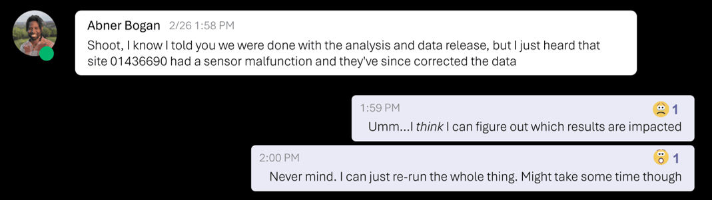
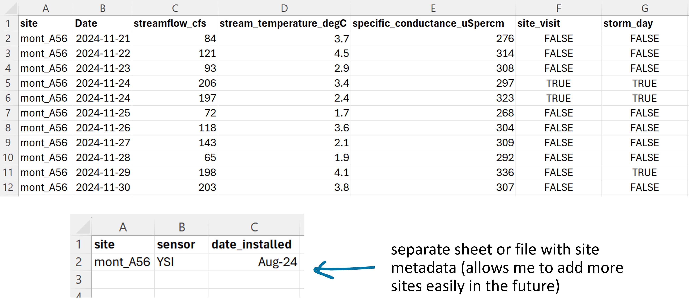

## Today's agenda {.smaller}

| Time (ET) | Minutes | Topic |
|---|---|---|
| 2:00 | 4 | Welcome and introductions |
| 2:04 | 5 | How the course works |
| 2:09 | 5 | Getting ready for the coding sessions |
| 2:14 | 3 | Module 1 overview |
| 2:17 | 22 | Open Science (with an activity) |
| 2:39 | 26 | Data Management (with an activity) |
| 3:05 | 20 | Data Publishing (with an activity) |
| 3:25 | 5 | Recap and questions |

::: notes
- Walk through the shape of the day: three short lessons, each ending in a hands-on activity.
- Module 1 is conceptual: no code today.
- Point out that the pre-reading covered funder policies and barriers, so we only recap them.
:::

## From the pre-reading

- Funders and journals increasingly **require** shared data and metadata (NSF's Public Access Policy, AGU's Position Statement on Data).
- Working openly has real **barriers**: fear of sharing errors, extra time up front, and incentives that favor novel results.
- Practical starting points: **constructive code review**, **share early and often**, and **publish data and code as citable products**.

::: notes
- Quick recap of `session-01_module-01_data-best-practices_pre-reading.pdf`.
- Ask: "Who has had a funder or journal ask for a data statement?" Show of hands.
- If short on time: read the three bullets and move on.
:::

# Welcome {background-color="#1f4e79"}

::: notes
- Section divider: Welcome.
:::

## Welcome and introductions

- This course: **Federal Open Water Data for Researchers**, about 20 hours over four modules.
- Introduce yourself in the chat or out loud:
  - your name and institution
  - one river, lake or watershed you work on
  - one water data source you already use

::: notes
- Keep introductions brisk: about 2 minutes total if the group is large; use the chat.
- Note any learners who already use SWOT, NWM or USGS data: they can help others in Modules 3 and 4.
:::

## What you'll be able to do by the end {.smaller}

- Explain open science, FAIR and reproducibility, and why they matter.
- Outline a data management plan, and publish data in a suitable repository.
- Characterize river data from **NASA SWOT**, **NOAA NWM** and **USGS WDFN**.
- Adapt Python scripts to retrieve data from all three with recommended tools.
- Choose an approach that scales to long records and many locations.
- Compare all three products for a single flood event.

::: notes
- These are the course learning objectives, one per line.
- Module 1 covers the first two; Module 2 the third; Module 3 the fourth and fifth; Module 4 the last.
- Agency order is always NASA → NOAA → USGS in this course.
:::

# How the course works {background-color="#1f4e79"}

::: notes
- Section divider: How the course works.
:::

## Course schedule {.smaller}

| Session | Date (2:00 pm ET) | Topic |
|---|---|---|
| 1 | Tue Nov 3 | Module 1: Data best practices |
| 2 | Thu Nov 5 | Module 2: Federal water data landscape |
| 3 | Tue Nov 10 | Module 3: Retrieve NASA SWOT data |
| 4 | Thu Nov 12 | Module 3: Retrieve NOAA NWM data |
| 5 | Tue Nov 17 | Module 3: Retrieve USGS WDFN data |
| 6 | Thu Nov 19 | Module 4: Federal water data synthesis |

Then: **Tue Dec 1** peer review and **Thu Dec 3** demos.

::: notes
- Sessions 1, 3, 4 and 5 are 90 minutes; sessions 2 and 6 are 120 minutes.
- Details on the Dec 1 peer review and Dec 3 demos are in Canvas.
:::

## Where things live

- **Canvas:** the slides and reading PDFs for each session, the module quizzes and announcements.
- **Readings:** some sessions have a short pre-reading (read before) or post-reading (read after), about 15 minutes each.
- **HydroShare:** the learner bundle of notebooks and environment files for the coding sessions (Modules 3 and 4).
- **Office hours:** see Canvas.

::: notes
- Show learners where the session materials and quizzes are in Canvas.
- The slides are the lessons: everything you need is in the slides and readings.
- Expect: "Is there a textbook?" No; the slides, readings and notebooks are the course.
:::

## Module quizzes

- One quiz per module, about **10–15 minutes**, multiple choice.
- They are **formative**: retakes are unlimited, and every question explains the correct answer.
- The Module 1 quiz covers today's three lessons: **see Canvas**.

::: notes
- Emphasize that the quizzes are for checking understanding, not for ranking.
- Some questions are "select all that apply".
:::

## Getting ready for the coding sessions

Modules 3 and 4 run Python notebooks. Before **Session 3 (Nov 10)**:

- Create a free **NASA Earthdata login** at [urs.earthdata.nasa.gov](https://urs.earthdata.nasa.gov) (needed to download SWOT files).
- Request a **USGS Water Data API key** at [api.waterdata.usgs.gov/signup](https://api.waterdata.usgs.gov/signup/) (optional; it raises your request limits).
- Open the learner bundle from HydroShare; each lesson has its own **conda environment** file. See 'How to' guide for launching HydroShare compute session.

::: notes
- A conda environment is an isolated set of Python packages, defined by a file, so a lesson's code runs with known package versions.
- See 'How to' guide for launching HydroShare compute session: it covers opening the bundle in the hosted HydroShare environment.
- Expect: "Do I need an NOAA account?" No: the NWM lesson needs no credentials.
:::

## Keep credentials out of your code

- Store credentials in **environment variables**, never in a notebook, script or repository.
- NASA: `EARTHDATA_USERNAME` and `EARTHDATA_PASSWORD` (`earthaccess.login()` finds them).
- USGS: your key goes in `API_USGS_PAT`.
- Each coding session starts by checking these are set, without printing them.

::: notes
- An API key is a personal token that identifies you to a web service, often allowing higher request limits.
- This is the first data best practice of the course: secrets don't belong in shared code.
- Expect: "What's an environment variable?" A named value your operating system passes to programs; the Session 5 pre-reading shows how to store one in a conda environment, and Session 3 shows `earthaccess` finding them.
:::

# Module 1 overview {background-color="#1f4e79"}

::: notes
- Section divider: Module 1 overview.
:::

## Every dataset was shaped by someone's decisions

- How data are collected, processed, documented and shared decides whether results can be **checked, rebuilt and reused**.
- The person most likely to need to rebuild your work is **future you**, months or years later.
- If your future self could pick up the work without help, others probably can too.

::: notes
- This "future you" idea runs through all three lessons today.
- Module 1 has no code and no software environment.
:::

## Module 1 learning objectives {.smaller}

- Describe open science as a spectrum, and recognize that definitions vary.
- Explain FAIR, how it differs from open, and why CARE matters.
- Explain reproducibility, how it relates to replicability, and why it is a continuum.
- Apply three approaches: project organization, machine-readable data, documentation.
- Choose a repository, and decide whether to publish derived data as a snapshot or a recipe.

::: notes
- Three lessons: Open Science, Data Management, Data Publishing.
- The Module 1 quiz maps to these objectives.
:::

# Lesson 1: Open Science {background-color="#1f4e79"}

::: notes
- Section divider: Lesson 1: Open Science.
:::

## What is open science?

> "Open research aims to transform research by making it more reproducible, transparent, reusable, collaborative, accountable, and accessible to society."
>
> — [The Turing Way Community](https://book.the-turing-way.org/reproducible-research/open)

- Also called *open research*. Definitions vary between organizations.
- It is about **how research is carried out**, not only what is shared at the end.

::: notes
- Open science treats other scientists and disciplines as collaborators.
- Water science especially benefits: a fragmented community, data-intensive problems and funder mandates.
:::

## Open science is a spectrum

- **Open data**
- **Open code**
- Open access publications
- Open methods and protocols
- **Open processes**, such as developing code in a public repository and sharing work in progress

This module focuses mostly on open data, open code and open processes.

::: notes
- Ask: "Which of these do you already do?" Most people have done at least one.
- Groups that can help: The Turing Way, Openscapes, NASA's TOPS Open Science 101 (links in the pre-reading).
:::

## FAIR: data that people *and machines* can use {.smaller}

- **F**indable: metadata and data are easy to find for humans and computers.
- **A**ccessible: once found, users know how the data can be accessed.
- **I**nteroperable: data can be combined with other data and workflows.
- **R**eusable: data are well described, so they can be reused in new settings.

Source: [Wilkinson et al., 2016](https://doi.org/10.1038/sdata.2016.18); [GO FAIR](https://www.go-fair.org/fair-principles/)

::: notes
- Metadata: data about data: what the values are, their units and definitions, where and when they were collected, how they were produced and who to contact.
- FAIR is built throughout a project and "cashed in" when you publish (Lesson 3).
:::

## FAIR is not the same as open

- FAIR allows **authentication and authorization** where necessary.
- Restricted data can still be FAIR if the **rules for access are clear**.
- "Open" usually means clear and persistent ways to access data, code or papers, not access for everyone, all the time.
- Laws, ethics or data sovereignty can require restrictions.

::: notes
- This is the most common misconception; the activity at the end of this lesson tests it.
- Expect: "So is a dataset behind a free login open?" Mostly; it can be fully FAIR.
:::

## CARE: people and purpose

The CARE principles for Indigenous Data Governance ([GIDA](https://www.gida-global.org/careprinciples)) complement FAIR:

- **C**ollective benefit
- **A**uthority to control
- **R**esponsibility
- **E**thics

::: notes
- GIDA describes CARE as asking those who work with data to consider both people and purpose.
- In GIDA's words, Indigenous Peoples' rights and wellbeing should be the primary concern at all stages of the data life cycle.
:::

## CARE is a check on every project

- Before you use or share data, ask: do they relate to **Indigenous Peoples, lands or waters**?
- If they might, check the **terms attached to the data** and GIDA's guidance before going further.
- Understanding where your data come from is **each researcher's responsibility**.

::: notes
- Water data often relate to lands and waters with Indigenous rights and interests.
- CARE comes back in Lesson 3, under "Accessible".
:::

## Now you try it: FAIR or open? {.smaller}

For each dataset, mark the FAIR letters it meets (F, A, I, R) and whether it is **open** (anyone can get the files without asking).

1. A stream gage record from a public web service, with a permanent site ID and documented formats.
2. Satellite data from a national archive with a DOI; free, but needs a free account.
3. A repository record with readable metadata; CSV files released on request (sites on private land).
4. An Excel table on a lab shared drive ("anyone with the link"), no README.
5. Discharge values printed as a table in a PDF article supplement.

::: notes
- 5 minutes in pairs or alone, then 2 minutes to discuss.
- A DOI (Digital Object Identifier) is a permanent link to a dataset, paper or software.
- What learners should see: open and FAIR don't always go together.
:::

## FAIR or open? What you should see {.smaller}

- **2 and 3** are not fully open, but largely FAIR: findable, with clear access rules.
- **4** is open to anyone with the link, but barely FAIR: no persistent ID, no metadata, and it can vanish.
- **5** is easy to get but hard to reuse: values must be copied out of a PDF by hand.
- **1** is the most FAIR and open, but "R" still depends on metadata quality.

No dataset gets a clear ✓ for **Reusable**: it depends on the *quality* of metadata.

::: notes
- Reusability is one of the hardest parts of FAIR; peer review of data helps (Lesson 3).
- Excel is a proprietary format, so dataset 4 is not interoperable; CSV (dataset 3) is.
- Expect: disagreement on dataset 1's "R". That is the point: it depends on the metadata.
:::

# Lesson 2: Data Management {background-color="#1f4e79"}

::: notes
- Section divider: Lesson 2: Data Management.
:::

## A message you don't want to get

{fig-alt="A chat exchange. A colleague writes that a monitoring site had a sensor malfunction and the data have since been corrected, after the analysis and data release were finished. The reply: 'Umm... I think I can figure out which results are impacted,' then 'Never mind. I can just re-run the whole thing. Might take some time though.'" .r-stretch}

::: notes
- How you feel about this message depends almost entirely on how you managed your data, workflows and documentation.
- We'll return to this message at the end of the lesson.
:::

## Data management happens *during* the project

- The actions you take during a project so your methods are credible and others (and future you) can trust the results.
- Tidy data, documentation and metadata are **built in as you go**, not added at publication.
- It covers more than numbers: **the data**, **the metadata**, **the code** and **the methods** (protocols, SOPs, field notes).

::: notes
- FAIR has also been adapted for research software (Barker, 2022) and computational workflows (Wilkinson et al., 2025).
- Treat code as something others will need to access, understand and run.
:::

## Document every stage

, CC BY 4.0.](../../images/m01/02_data_management-reproducibility-overview.jpg){fig-alt="Illustration of a winding path from a person holding The Turing Way book, past bubbles labelled 'Here are my data', 'Here is my code' and 'Here are my tools', up to a person on a hilltop presenting 'Here are my results'." .r-stretch}

::: notes
- Results at the top rest on data, code and tools shared along the way.
:::

## Data management plans

A **data management plan** (DMP, or DMSP: data management and sharing plan) is a short document, written *before* the work starts, describing what data a project will create or use and how they'll be handled from start to finish ([Wong, 2026](https://www.cuahsi.org/uploads/pages/doc/DMP_guide_digital.pdf)).

- Decisions on formats, storage, documentation and sharing aren't made in a panic at the end.
- Build reproducibility in from the start, including the time and storage it takes ([Rosenberg et al., 2020](https://doi.org/10.1061/%28ASCE%29WR.1943-5452.0001215)).

::: notes
- Many funders now require a DMP or DMSP with a proposal.
- The full question-by-question table is in the post-reading.
:::

## What a DMP answers

- What data will you create or collect?
- What formats and standards will you use?
- How will you document them, and where will you store and back them up?
- How will they be shared and preserved (for example, HydroShare, with a DOI)?
- Who is responsible for what?
- Any access, privacy or licensing considerations?

::: notes
- Tips: treat it as a living document; plan the sharing step early; use your library's DMP tools and templates.
- The CUAHSI DMP guide (linked on the previous slide) has clickable links to templates and tools.
- If short on time: skip this slide; the post-reading has the table with water-project examples.
:::

## What do we mean by "reproducible"?

- **Reproducibility** (National Academies): consistent results from the same input data, code, methods and conditions.
- **Replicability**: consistent results across studies asking the same question, each with its own data ([NASEM, 2019](https://doi.org/10.17226/25303)).
- **This course:** methods can be easily **rebuilt** with the same data to recreate results, or with new data to update an analysis ([Platt, 2025](https://youtu.be/74GjxHnhlr0)).

::: notes
- The Turing Way adds "robust": different workflows on the same data give similar answers.
- Some fields use the two terms the opposite way round (Barba, 2018).
- Remember `final_v3_USE_THIS_ONE.xlsx`? Future you is a key audience.
:::

## Reproducibility is a continuum

).](../../images/m01/02_data_management-continuum-of-reproducibility.png){fig-alt="A three-tier pyramid titled Continuum of reproducibility. Bottom tier: document and rebuild your own analysis (documentation, scripts). Middle tier: rebuild, reuse, and debug analyses plus track changes through time (scripted data access, version control, modular code). Top tier: build and collaborate on automated analyses (dependency tracking, automated workflows)." .r-stretch}

::: notes
- Start with documentation and scripts.
- Next: version control (Git, commits), reusable functions.
- Top: automated pipelines with dependency tracking (`targets` in R, `Snakemake` in Python) and a recorded environment.
:::

## Why it's worth it

- Only **1.6%** of 360 hydrology and water resources articles tested had reproducible results ([Stagge et al., 2019](https://doi.org/10.1038/sdata.2019.30)).
- Redo an analysis quickly when corrected data arrive.
- Be confident a change carried through to your results.
- Others can use and build on your methods; papers and reviewer responses come together faster.

::: notes
- Barriers are real: time, effort, lack of recognition (Gomes, 2022; Whitaker, 2019).
- Back to the corrected-sensor message: with scripts and a pipeline, the reply becomes "No problem. Easy fix on our end!"
:::

## Three simple approaches

The first tier of the continuum, and a foundation for FAIR:

1. **Project organization** → findable and reusable (F, R)
2. **Machine-readable data** → interoperable (I)
3. **Documentation** → reusable (R)

No advanced technical skill needed: just some thought and a little time.

::: notes
- You don't need to think of yourself as a programmer to make progress.
:::

## 1. Project organization

- **Ordered folders:** a numbered folder per phase, each with the same subfolders.
- **Keep raw data untouched:** correct in code or in a separate copy.
- **A file naming convention:** pick one deliberately, write it down, use it. Dates (`YYYY-MM-DD`) and names that match the script that made the file.
- **Team habits:** one shared source of truth; agree on names early; controlled fields for hand-entered data.

::: notes
- The exact convention matters less than having one.
- Example: `regression_model_v1.R` creates `regression_model_v1_output.csv`.
:::

## An example structure

{fig-alt="Left: five numbered phase folders, 01_fetch, 02_clean, 03_model, 04_summarize and 05_visualize. Middle: each phase holds in, out, src and tmp subfolders. Right: output files named with a YYMMDD date prefix, such as 240818_regression_model_v1_output.csv, next to the scripts with matching names, such as regression_model_v1.R." .r-stretch}

::: notes
- Each output can be traced back to the script that created it.
:::

## 2. Machine-readable data: habits to avoid

{fig-alt="A spreadsheet of daily discharge, temperature and specific conductance for one site. Site notes sit in the top rows above the data, storm days are marked only by blue shading, merged cells label a site visit, and the units are in a row below the data. Labels list the four problems: merged cells, color as an indicator, mixed types in a column, and contextual information mixed with the data." .r-stretch}

::: notes
- Machine-readable data are structured so code can load them into a usable state.
- Merged cells break one-value-per-cell; color is lost when code reads the file; `12.4 cfs` makes a column text; notes above the data hide where the data start.
:::

## 2. Machine-readable data: a tidy table

{fig-alt="The same data as one tidy table with columns site, Date, streamflow_cfs, stream_temperature_degC, specific_conductance_uSpercm, site_visit and storm_day (TRUE or FALSE), and a separate small table of site metadata with columns site, sensor and date_installed." .r-stretch}

::: notes
- Every column is one type of information; every row one observation.
- Color-coded information becomes a column (`storm_day`, TRUE/FALSE). Color can still be added as a bonus.
- Separate site metadata means new sites can be added without restructuring.
:::

## 3. Documentation

- **In-line comments** that guide a reader through clever or complex code.
- **Metadata** for your data: units, definitions and sources.
- A **`README.md`**: the front page of your project (what it is, how to run it, packages and versions).
- **Test it with a colleague:** watch them follow your run instructions.

::: notes
- A README is a plain-text or Markdown file that introduces a project or dataset.
- As projects grow to dozens of scripts, early documentation stops confusion months later.
- These habits make version control and pipelines easier to adopt later.
:::

## Now you try it: a project left behind

A colleague left you their summer-storm project. Your PI wants it updated with this year's storm.

```text
storm_project/
  data.xlsx
  data_FINAL.xlsx
  final_v3_USE_THIS_ONE.xlsx
  Copy of gage data (2).csv
  rain gauge.csv
  analysis.py
  analysis_new_TRY.py
  fig1.png
  figure for report.png
  notes.docx
```

1. List what makes it hard to reproduce. 2. Sketch a numbered folder structure. 3. Rename the files.

::: notes
- 6 minutes working, 2 minutes sharing.
- Ask one or two learners to share their folder sketch.
:::

## A project left behind: what you should see

At least five problems:

- Several "final" copies and **no single source of truth**.
- Raw records that **can't be told apart** from edited copies.
- Scripts **not linked** to the outputs they make.
- **Vague file names** with spaces.
- **No README**.

::: notes
- Any naming convention is fine if it's chosen deliberately and used consistently.
- Example answer on the next slide.
:::

## A project left behind: one cleaner version

```text
storm_response/
  README.md
  01_raw/
    in/240715_stream_gage_discharge_raw.csv   # never edited by hand
    in/240715_rain_gauge_precip_raw.csv
  02_process/
    src/align_rain_and_discharge.py
    out/240720_align_rain_and_discharge_output.csv
  03_figures/
    src/plot_storm_hydrograph.py
    out/240720_plot_storm_hydrograph_output.png
```

::: notes
- One copy of each file; raw data separate and untouched; outputs named after the script; dates and no spaces; a README with the run order.
- Optional homework: sketch the same structure for one of your own projects.
:::

# Lesson 3: Data Publishing {background-color="#1f4e79"}

::: notes
- Section divider: Lesson 3: Data Publishing.
:::

## Why publish data and code on their own?

- A paper summarizes one analysis; the data and code are the **evidence** behind it, and can support many more.
- Published products can be checked, reused and built upon, and **you get credit**.
- Papers that cite their data are [more likely to be cited](https://doi.org/10.1371/journal.pone.0230416).
- [AGU journals](https://data.agu.org/resources/agu-data-software-sharing-guidance) require an Availability Statement; "available from the authors" is not accepted.

::: notes
- The goal is a product that stands the test of time: still findable, openable and understandable after the team moves on.
- A lab website, Google Drive, Box or an FTP server is not citable and not permanent storage.
:::

## Share, cite, mention

- **Share** (with a DOI) the data and code you produced: the data behind your figures, the script that makes them, a model you developed.
- **Cite** the data and software others created that you reused.
- **Mention** tools you used but can't archive, such as commercial software, with the version.

::: notes
- Choose your repository early: some review steps take a few weeks.
- Share a private review link with editors and reviewers, then make everything public and cite the DOIs by acceptance.
:::

## FAIR in action: one decision per letter

- **F:** a persistent identifier is assigned and the data are placed where they can be searched.
- **A:** how files are retrieved, who may retrieve them, and any restrictions are stated.
- **I:** open, non-proprietary formats and shared vocabularies are chosen.
- **R:** a license and rich metadata are attached.

::: notes
- A persistent identifier is a permanent, unique label for a dataset, paper or person: a DOI for a dataset, an ORCID iD for a researcher.
- An embargo withholds files for a set period while the record (and often the DOI) can be found.
- Checkers like DataONE's MetaDIG sort automated checks into F, A, I and R, but measure machine-readable metadata, not data correctness.
- Each letter in detail: post-reading.
:::

## Reusable needs a license and a README

- **License:** without one, others have no clear permission to reuse your work. CC0 or CC BY 4.0 for data; MIT, BSD or Apache 2.0 for code ([choosealicense.com](https://choosealicense.com)).
- **README:** what each file is, variables and units, how the data were made, software needed, how to cite.
- **Provenance:** where your inputs came from, what you did, which code version produced the outputs.

::: notes
- Provenance is the record of where data came from and what was done to them.
- If data are complex to read (multi-file NetCDF, Zarr), share a short script that loads them and makes one plot. It doubles as a test.
:::

## Choosing a repository

- Does it give a **DOI**, and handle new versions?
- Do its **metadata fields** fit your data?
- Does it **review or curate** submissions?
- Will it **preserve** data long term?
- Will the **community** most likely to reuse your data find it there?
- Can it take your **file sizes and types**?

::: notes
- Drawn from the AGU Learning Workshop by Vrouwenvelder & Platt (2024), led by AGU Publishing with CUAHSI support.
:::

## Generalist or domain-specific?

- **Generalist** (Zenodo, Harvard Dataverse, Figshare): any data type; DOIs and solid metadata; little curation. Not a lesser choice: Zenodo's GitHub integration is common for code.
- **Domain-specific** (HydroShare, EDI): field-specific metadata, stricter guidelines, and your data in front of the community most likely to use it.
- Universities, funders and governments run repositories too: ask your librarian.

::: notes
- Generalist repositories account for a large share of data and software citations.
- The HydroShare vs. EDI comparison table is in the post-reading.
:::

## HydroShare in brief

- Run by CUAHSI. The unit of content is a **resource**: data, models, code, notebooks and teaching materials, with metadata.
- **Sharing in stages:** private → shared → discoverable → public → published.
- **Publishing is permanent:** a DOI, and content, title and authorship are locked.
- **Data and compute together:** linked JupyterHub and the [`hsclient`](https://github.com/hydroshare/hsclient) Python package.

::: notes
- Minimum metadata: a descriptive title, an abstract, and at least three keywords including geographic ones; a light staff review.
- Don't publish test resources.
- The learner bundle for this course is on HydroShare.
- CUAHSI's Data Publishing Program is a short virtual cohort twice a year; details in the post-reading.
:::

## Publishing derived data: snapshot or recipe?

- **Check the license first:** you inherit restrictions and can't loosen them.
- **Recipe:** if the source is large, stable, open and versioned, publish your code and a precise pointer.
- **Snapshot:** if the source is short-lived, revised or hard to access, publish the subset you used. Often, do both.
- **Document provenance** and **give credit** to the source.

::: notes
- Avoid mirroring whole archives: costly, goes stale and splits citations.
- Plan for change: record the source version, and be ready to publish a new version.
- Real example: the USGS data release of NWM v1.2 output at about 18,000 gage locations (doi.org/10.5066/P9ZRX948).
:::

## Now you try it: snapshot or recipe?

Decide **snapshot** or **recipe**, and list what you would record:

1. Discharge from a gage network, marked *provisional* (may still be revised).
2. A subset of a long-term model simulation in a public archive with a DOI.
3. A flood forecast that the provider posts for only a few days.

::: notes
- 3 minutes alone, then discuss.
- Provisional data: recent data not yet reviewed and approved, which can change.
:::

## Snapshot or recipe? What you should see {.smaller}

1. **Snapshot:** revised values won't match your results. Record site ID, variable, provisional status, retrieval date.
2. **Recipe:** the archive is stable and citable. Record the DOI, model version, subset (place, dates, variables) and access date.
3. **Snapshot:** the original will disappear. Record the provider, issue time and what you kept.

In every case: cite the source, carry its license, publish with a DOI.

::: notes
- These three cases come back in Modules 3 and 4 with real USGS and NOAA data.
:::

# Wrap-up {background-color="#1f4e79"}

::: notes
- Section divider: Wrap-up.
:::

## Recap

- **Open science** is a spectrum; **FAIR** is not the same as open, and **CARE** asks who the data are about and who benefits.
- **Data management** happens during the project; reproducibility is a continuum that starts with organization, machine-readable data and documentation.
- **Publishing** in a repository with a DOI, a license and a README makes your work last; derived data need a snapshot, a recipe, or both.

::: notes
- Ask for one question or "aha" from the chat.
:::

## What's due and what to read

- **Module 1 quiz:** see Canvas.
- **Post-reading:** `session-01_module-01_data-best-practices_post-reading.pdf` (FAIR in action in detail, repositories, peer review of data and code).
- **Before Session 3:** create your NASA Earthdata login and (optionally) a USGS API key.
- **Next session (Thu Nov 5):** Module 2, the Federal water data landscape.

::: notes
- Leave the remaining time for questions.
:::

## Questions?

::: notes
- About 5 minutes.
- Expect: "Which repository should I use for my thesis data?" Walk through the six questions on the "Choosing a repository" slide.
:::
