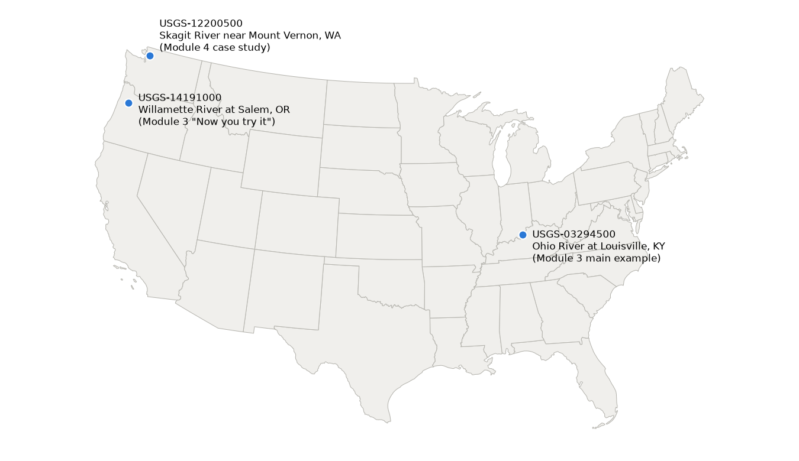

## Today's agenda {.smaller}

| Time (ET) | Minutes | Topic |
|---|---|---|
| 2:00 | 3 | Agenda and pre-reading recap |
| 2:03 | 12 | Module 2 overview: one framework for three products |
| 2:15 | 28 | Meet NASA SWOT |
| 2:43 | 30 | Meet NOAA NWM |
| 3:13 | 5 | Break |
| 3:18 | 25 | Meet USGS WDFN |
| 3:43 | 10 | Activity: compare the three products |
| 3:53 | 7 | Recap and questions |

::: notes
- No coding today: the short code on slides shows what a request looks like; Module 3 runs it.
- Agency order is always NASA → NOAA → USGS.
:::

## From the pre-reading

- **NASA SWOT** is a satellite (NASA and CNES) that surveys surface water from space, including rivers that have never been gaged.
- **NOAA NWM** is a continental-scale model that simulates and forecasts streamflow; it is guidance that complements official NWS river forecasts.
- **USGS WDFN** is how USGS publishes the water data stored in NWIS; the legacy NWISWeb and WaterServices are being decommissioned.

::: notes
- Recap of `session-02_module-02_federal-water-data-landscape_pre-reading.pdf`.
- Ask: "Which of these three have you used before?"
:::

# Module 2 overview {background-color="#1f4e79"}

## Know what a product *is* before you code

- What it measures or models, and how the values are made.
- Where and when data exist, and at what resolution.
- What can go wrong.

**Learning objective:** characterize the river data products from NASA SWOT, NOAA NWM and USGS WDFN, including variables, derivation, spatial and temporal resolution, and known limitations.

::: notes
- Module 3 retrieves these data; Module 4 combines them. This module is the foundation.
:::

## One framework for three products {.smaller}

| Shared concept | Question it answers |
|---|---|
| Location identifier | *Where* is this value? |
| Variable | *What* was measured or modeled? |
| Variable unit | In what units? |
| Time | *When*, and how often? |
| Data quality flag(s) | How much should I trust it? |
| Version / provenance | Which release, from where? |
| Data unit | What is one "file" or record? |

::: notes
- Each agency has its own vocabulary: granules and reaches (SWOT), COMIDs and configurations (NWM), monitoring locations and parameter codes (USGS).
- Underneath, they answer the same seven questions. Every product today starts with this table.
:::

## Four things to watch for

- **Quality flags mean different things:** a SWOT flag rates one observation; a USGS approval status says whether a person has reviewed it; NWM output has no per-value flag.
- **Units and reference points differ:** NWM streamflow is in m³/s, USGS discharge in ft³/s (1 m³/s ≈ 35.31 ft³/s).
- **"Reach" means different things:** a SWOT reach (~10 km, SWORD) and an NWM reach (an NHDPlus segment) come from separate networks.
- **Version and provenance** make your work repeatable.

::: notes
- SWOT water surface elevation is in meters above a global geoid; USGS gage height is in feet above a local gage datum. 120 m and 20 ft can describe the same water surface.
- Streamflow and discharge are the same quantity: volume of water passing per second.
- Products are reprocessed, models upgraded and provisional values revised: record the version and retrieval date (Module 1's provenance).
:::

## The course's example rivers

{fig-alt="Map of the contiguous United States with three labeled points: USGS-12200500, Skagit River near Mount Vernon, Washington (Module 4 case study), in the far northwest; USGS-14191000, Willamette River at Salem, Oregon (Module 3 'Now you try it'), just south of it; and USGS-03294500, Ohio River at Louisville, Kentucky (Module 3 main example), in the east." .r-stretch}

::: notes
- Ohio River at Louisville, KY: the example figures today, and Module 3's main example.
- Willamette River at Salem, OR: Module 3's "Now you try it".
- Skagit River, WA: Module 4's December 2025 flood case study.
- The script that made this map is in the post-reading.
:::

# Meet NASA SWOT {background-color="#1f4e79"}

## NASA Surface Water and Ocean Topography (SWOT)

- A satellite from NASA and CNES, with contributions from the Canadian and UK space agencies.
- Its **KaRIn** radar (Ka-band Radar Interferometer) makes the first global survey of surface water.
- Measures the **elevation, width and slope** of rivers, lakes and reservoirs, rather than streamflow at fixed points.
- Closes a gap: most of the world's rivers have no streamgage.

::: notes
- This course covers only SWOT's surface water (hydrology) measurements; SWOT also measures the ocean.
- Learn more: NASA's SWOT mission page and the Earthdata SWOT resources page.
:::

## SWOT in the shared framework {.smaller}

| Shared concept | SWOT (RiverSP product) |
|---|---|
| Location identifier | `reach_id` (~10 km) / `node_id` (~200 m spacing), from **SWORD** |
| Variable | water surface elevation (WSE), width, slope, water area |
| Variable unit | meters (WSE, width), m/km (slope) |
| Time | overpass time (UTC), e.g. `2025-01-09T11:18:10Z` |
| Data quality flag(s) | summary flags (`reach_q`, `wse_qual`, …) plus bitwise flags |
| Version / provenance | product version (e.g. `D`) and collection DOI |
| Data unit | granule: one stretch of one satellite pass |

::: notes
- SWORD: the SWOT River Database, a global river network built before launch so repeat passes tie back to the same features.
- RiverSP: River Single-Pass Vector product: one record per reach (or node) per overpass.
- A granule is the smallest unit NASA distributes, usually one file.
- WSE is height above the geoid (EGM2008): the shape the ocean would take under gravity alone, the reference for "above sea level".
:::

## How SWOT values are made

**SWOT measures water surface elevation, width and slope. It does not measure discharge**, and SWOT discharge estimates are not yet ready for research use.

- Launched **December 16, 2022**.
- Raw radar returns → pixel detections (the **PIXC** product) → reach- and node-scale values on the SWORD network.
- Discharge estimates (SWORD of Science, a Level 4 product) are still in development.

::: notes
- Pixel cloud (PIXC): the lower-level product of individual radar pixels classified as water or land.
- Expect: "Can I get discharge from SWOT?" Not yet for research use in this course; Module 4 discusses SoS.
:::

## Orbits and versions

- **1-day repeat** "fast-sampling" calibration orbit: Dec 2022 – July 2023.
- **21-day repeat science orbit** since mid-2023: what most hydrology uses.
- Product versions evolve (Beta Pre-Validated → Version C → Version D), toward fully validated.
- A new version **reprocesses old observations**: record it as provenance.

::: notes
- Each repeat of the orbit is a cycle; each numbered pass is one half-orbit.
- Check the version and validation status of any dataset you use; release notes are on the SWOT documentation page.
:::

## Where SWOT sees

- **Global:** at least 90% of Earth's surface, at least once every 21 days.
- **Vector** reaches and nodes (RiverSP, shapefiles) and a gridded **Raster** product (100 m and 250 m UTM grids).
- **Is my river wide enough?** Plan on rivers **at least 100 m wide**. Usable data as narrow as ~50 m are possible but not guaranteed.
- Vector coordinates are latitude/longitude; Raster scenes are on UTM grids.

::: notes
- SWORD includes rivers about 30 m wide and up, but that is the network, not what SWOT can measure.
- UTM zone: 60 numbered zones, each 6° of longitude, each with its own flat x/y grid in meters.
- Caveat: a seasonal mask removes part of the Canadian Arctic Archipelago (roughly Dec 1 – Mar 1).
:::

## When SWOT sees

- Science-orbit data from **mid-2023**, ongoing (the mission is in extended operations).
- Revisits on a **21-day cycle**; often more where swaths overlap.
- Example: the Ohio River reach at Louisville sits under **four passes**: 118 observations from January 2025 to October 2026, a median of about 9 days apart.
- Released per granule as processed, not on a fixed daily schedule.

::: notes
- A swath is the strip of ground imaged on each side of the satellite's path; data outside it are missing.
- Not a regular daily schedule like a model or a gage.
:::

## What SWOT data look like

), via PO.DAAC `hydrocron`, accessed 2026-10-08.](../../images/m02/01_meet_nasa_swot-ohio-reach-wse.png){fig-alt="Scatter plot of SWOT water surface elevation for reach 74267300251 from January 2025 to September 2026. Most points lie between 119 and 124 meters, with high values near 131 meters in February and April 2025. 114 points are blue (reach_q = 1, suspect) and 4 are orange squares (reach_q = 2, degraded); none are flagged good." .r-stretch}

::: notes
- Each dot is one overpass, reduced to one WSE for the ~10 km reach.
- Point out: irregular timing (sometimes two in a day); the April 2025 flood as a jump of several meters; no observation is flagged good (`reach_q` = 0).
:::

## Reading the quality flags

- Summary flags: **0 = good, 1 = suspect, 2 = degraded, 3 = bad**.
- "Suspect" does not mean "wrong": something *might* affect the value.
- At this reach: `reach_q` ≤ 1 keeps **114 of 118**; `reach_q` = 0 keeps **nothing**.
- **Filter on `reach_q` first, then check the flag for the variable you use.** Look at the flag distribution before choosing a threshold.

::: notes
- A bitwise flag (e.g. `reach_q_b`) packs several yes/no checks into one integer, so values look arbitrary (`14`, `524298`). Decode it with the product description document (PDD) only when you need to know why.
- A reach can have usable WSE while width is flagged.
- Still sanity-check values, e.g. compare the February and April 2025 highs with what you know.
:::

## Accuracy and limitations

- Commonly cited target: **~10 cm** vertical (WSE) precision. A mission-level target, not a per-observation guarantee.
- Performance varies with river width, roughness and local factors; PO.DAAC points users to the product description documents.
- **Braided or multi-channel rivers** aren't well represented: SWORD reaches assume a single centerline.

::: notes
- Related products not covered: LakeSP (lakes), ocean/sea-surface height, PIXC.
:::

## Asking for a SWOT reach time series

```python
params = {
    "feature": "Reach", "feature_id": "74267300251",
    "start_time": "2025-01-01T00:00:00Z", "end_time": "2026-10-01T00:00:00Z",
    "output": "csv", "fields": "reach_id,time_str,wse,width,reach_q,collection_shortname",
}
resp = requests.get("https://soto.podaac.earthdatacloud.nasa.gov/hydrocron/v1/timeseries",
                    params=params, timeout=60)
df = pd.read_csv(io.StringIO(resp.json()["results"]["csv"]))
```

One row per overpass: `wse` (m), `width` (m), `reach_q`, and `collection_shortname` (the product and version: keep it as provenance).

::: notes
- `hydrocron` is a PO.DAAC web API that returns SWOT reach and node time series as CSV or GeoJSON. No login needed.
- Missing values use the fill value `-999999999999`; drop very negative `wse`.
- You don't run this today; Session 3 does. The full script is in the post-reading.
:::

## Using SWOT data

- **Cite** the product DOI and version, plus access date, e.g. RiverSP Version D: [doi:10.5067/SWOT-RIVERSP-D](https://doi.org/10.5067/SWOT-RIVERSP-D).
- **Access:** open data in NASA Earthdata Cloud via PO.DAAC; downloads need a free **Earthdata Login**.
- Two routes in this course: [`earthaccess`](https://earthaccess.readthedocs.io/en/latest/) (whole granules) and [`hydrocron`](https://podaac.github.io/hydrocron/) (reach and node time series).
- **Contact:** podaac@podaac.jpl.nasa.gov or the [Earthdata Forum](https://forum.earthdata.nasa.gov/).

::: notes
- PO.DAAC: NASA's Physical Oceanography Distributed Active Archive Center.
- `earthaccess`: a Python library for logging in to NASA Earthdata and searching, downloading or streaming granules. PO.DAAC staff describe it as their preferred route.
- Version upgrades can change values for the same reach: treat multi-version time series as non-homogeneous.
:::

# Meet NOAA NWM {background-color="#1f4e79"}

## NOAA National Water Model (NWM)

- Produced by NOAA's [Office of Water Prediction](https://water.noaa.gov/about/nwm), part of the National Weather Service.
- A **continental-scale hydrologic model**, not an observing network.
- Simulates and forecasts streamflow (plus soil moisture, snowpack and more) for **3.4 million miles** of rivers and streams.
- **Supplemental guidance:** official forecasts come from NWS River Forecast Centers at about 4,000 locations.

::: notes
- NWM gives forecasters, emergency managers and floodplain managers guidance where there are no official forecast points.
- Viewer: the National Water Prediction Service at water.noaa.gov.
:::

## NWM in the shared framework {.smaller}

| Shared concept | NWM |
|---|---|
| Location identifier | `feature_id` (= NHDPlus **COMID** in CONUS) |
| Variable | streamflow |
| Variable unit | m³/s (the NOAA NWM API labels it `CMS`) |
| Time | **reference time** + **valid time** (UTC) |
| Data quality flag(s) | none per value |
| Version / provenance | model version and configuration (e.g. v3.0, `medium_range`) |
| Data unit | one output file per timestep (`channel_rt` for streamflow) |

::: notes
- Forecast reference time: when a forecast was issued. Valid time: the time a value applies to. Lead time = valid time − reference time.
- The same valid time appears in many forecasts issued at different reference times.
- CONUS: the contiguous United States.
:::

## NHDPlus and COMIDs

- **NHDPlus:** the USGS geospatial dataset that breaks the U.S. stream network into reaches, with catchments and up/downstream connections.
- **COMID:** the unique numeric ID of one NHDPlus reach.
- The NWM doesn't define its own river network: it **runs on NHDPlus**, so NWM `feature_id` = COMID in CONUS.
- That's why tools like the **NLDI** can look up a COMID from a location.

::: notes
- NLDI: Network Linked Data Index, a USGS web service that links monitoring locations to NHDPlus reaches and navigates along the network.
- Catchment: the land area draining directly to one reach.
- Outside CONUS, the NWM uses arbitrary reach identifiers.
:::

## How NWM values are made

**NWM values are model output, and a new model version can change the estimates for the same reach and time.**

- A land-surface model (snowmelt, infiltration, runoff on a grid) + channel and reservoir routing on NHDPlus.
- Driven by weather inputs: **forcing**.
- The analysis configuration uses **data assimilation** of real-time observations, including USGS gages.

::: notes
- Forcing: precipitation, temperature, radiation and other weather inputs.
- Data assimilation: adjusting a model while it runs so it stays close to observations.
:::

## Model versions matter

- Operational since **August 2016**: v1.0, v1.2, v2.0, v2.1, v3.0, v3.1.
- Each version can meaningfully change streamflow at the same `feature_id`.
- A Texas comparison of v2.1 and v3.0 at 610 USGS gages found gains in v3.0, but **both struggle with storm peak magnitude and timing** ([J. Hydrol. Reg. Stud., 2025](https://doi.org/10.1016/j.ejrh.2025.102196)).
- The version is in each NetCDF file: `ds.attrs['NWM_version_number']`.

::: notes
- Check OWP release notes before combining data across versions; record the version you used.
- What changed in v3.0 is listed in the post-reading.
:::

## Where the NWM runs

- **v3.1:** CONUS plus contributing areas, and separate domains for Hawaii, Puerto Rico/USVI and southern Alaska.
- Streamflow: one value per `feature_id`, over **2.7 million reaches**.
- Land-surface variables on **1 km grids**; ponded water and soil saturation on 100–250 m grids.
- Streamflow output has **no coordinates**: join `feature_id` to the NHDPlus reach to map it.

::: notes
- NHDPlus uses the USA Contiguous Albers Equal Area projection (NAD83); gridded output uses a Lambert Conformal Conic grid. Module 3 tools take and return EPSG:4326.
- Extent depends on version: only v3.0+ covers Alaska, Hawaii and Puerto Rico/USVI.
:::

## Retrospective vs. forecasts

- **Retrospective simulation:** one continuous run over decades of historical weather. The v3.0 run covers **Feb 1979 – Jan 2023**, hourly.
- It is **not** a collection of old forecasts: it is the model's best reconstruction of past streamflow, including ungaged reaches.
- **Operational forecasts** since August 2016; archived past forecasts show what the model predicted at the time.

::: notes
- The retrospective is the main source of long-term, reach-level historical streamflow for ungaged locations.
- Different inputs: the retrospective is driven by AORC; short-range forecasts by HRRR and RAP.
:::

## Which configuration do I want? {.smaller}

| Configuration | What it's for | Horizon | Interval | Issued |
|---|---|---|---|---|
| Retrospective | Long record, ungaged reaches | 1979–2023 (v3.0) | hourly | once per version |
| `analysis_assim` | Best estimate of now | last 3 hours | hourly | hourly |
| `short_range` | Next-day forecasts | 18 hours | hourly | hourly |
| `medium_range` (deterministic) | Coming week | 10 days | hourly (API) | 4× a day |
| `medium_range` (ensemble) | Coming week, 6 members | 8.5 days | hourly (API) | 4× a day |
| `long_range` | Outlooks, 4 members | 30 days | 6-hourly | 4× a day |

::: notes
- Reproduce a past flood or get a long record at an ungaged reach → retrospective.
- Assess forecast skill for a past flood → archived forecasts.
- What the model predicts now → a current forecast.
- Ensemble member: one of several runs with slightly different inputs; their spread is a rough guide to uncertainty.
- Forecast latency is roughly 1–2 hours after cycle time.
:::

## What NWM forecasts look like

{fig-alt="Line chart of NWM medium-range streamflow forecasts for COMID 10164004 issued 2026-10-08 18:00 UTC. Flow dips to about 930 cubic meters per second, rises to about 1,890 on October 10, then declines to about 1,050 by October 17. Member 1 (blue) continues to October 18; members 2 to 6 (gray) end on October 17 and spread slightly, between about 1,020 and 1,150." .r-stretch}

::: notes
- Everything right of the dotted line is a prediction for one reference time. Members spread apart as lead time grows; member 1 runs a day and a half longer.
- A forecast is identified by its reach and its reference time; six hours later a new one replaces it.
- This is model output, not checked against the gage here; Module 4 compares forecasts with observations.
- The API keeps only the latest few days, so this can't line up with the April 2025 flood.
:::

## No per-value quality flag

- Quality depends on **model version**, **configuration** and **how well the basin is calibrated**.
- Known issues (like missed storm peaks) are caveats on the **whole time series**, not flags on values.
- Quality degrades in **ungaged, heavily regulated or poorly calibrated** basins.

::: notes
- Contrast with SWOT (per-observation flags) and USGS (approval status).
- Expect: "So how do I know if a value is good?" Compare with observations (Module 4), and know the version and configuration.
:::

## Asking for the latest NWM forecast

```python
COMID = 10164004   # NHDPlus reach (NWM feature_id), Ohio River at Louisville, KY
url = f"https://api.water.noaa.gov/nwm/v1/streamflow/forecast/nwm_feature_id/{COMID}/"
resp = requests.get(url, params={"configuration": "medium_range", "latest": "true"},
                    timeout=60)
run = resp.json()[0]          # one forecast run for this reach
print(run["configuration"], run["reference_datetime"], run["units"])
# medium_range 2026-10-08T18:00:00Z CMS
```

No key needed. The API serves only the **latest** runs, so your numbers will differ.

::: notes
- On 2026-10-08, member 1 had 240 hourly values and members 2–6 had 204 each.
- Full script in the post-reading; Session 4 runs it.
:::

## Using NWM data

- **Cite** the product, version and access date, e.g. *"NOAA National Water Model Short-Range Forecast was accessed on [DATE] from https://registry.opendata.aws/noaa-nwm-pds."*
- **Access:** open data via NOAA Open Data Dissemination (**NODD**) on AWS and Google Cloud; ~48 hours on **NOMADS**.
- **Current forecasts:** the NOAA NWM API. **Past forecasts:** the cloud archive (NetCDF). **Retrospective:** NetCDF or Zarr.
- Forecasts **expire** from the API and NOMADS: keep the configuration, reference time, version and a copy of what you used.

::: notes
- Past forecasts are on Google Cloud (free, no account), which `hydrotools` reads by default; also mirrored on AWS.
- kerchunk/virtual Zarr references are small index files that let tools read only the chunks they need.
- This is Module 1's "snapshot" case: short-lived forecasts.
- Contact: NOAA OWP (NWM about page); NODD delivery: nodd@noaa.gov.
:::

## Break: 5 minutes {background-color="#1f4e79"}

::: notes
- Back at 3:18 pm ET.
:::

# Meet USGS WDFN {background-color="#1f4e79"}

## USGS Water Data for the Nation (WDFN) {.smaller}

- USGS collects water data at **monitoring locations** with automated sensors and manual measurements, stored in **NWIS**.
- **WDFN** is how USGS publishes it: the website and the **USGS Water Data APIs**.
- Data types: **continuous**, **daily**, **field measurements** and discrete samples.
- This course uses the modernized APIs through the `dataretrieval` package's `waterdata` module.

::: notes
- NWIS: the National Water Information System, the USGS database behind WDFN.
- NWISWeb and WaterServices are legacy and being decommissioned; see the NWISWeb Decommission Campaign Summary.
- `dataretrieval`: the USGS Python package for retrieving USGS water data.
:::

## WDFN in the shared framework {.smaller}

| Shared concept | WDFN |
|---|---|
| Location identifier | `monitoring_location_id`, e.g. `USGS-03294500` |
| Variable | discharge (parameter code `00060`); gage height (`00065`) |
| Variable unit | ft³/s (`ft^3/s`); gage height in feet |
| Time | timestamp: continuous (~15 min, UTC) or daily (local day) |
| Data quality flag(s) | `approval_status` (`Provisional` / `Approved`), `qualifier` |
| Version / provenance | service and retrieval date (no version number) |
| Data unit | one time series per location + parameter (+ statistic) |

::: notes
- Parameter code: a five-digit code for a variable. Statistic code: how values were summarized, e.g. `00003` for the daily mean.
- Qualifier: a remark on a value, e.g. `['ESTIMATED']` during ice; usually empty.
- Each row has a `last_modified` timestamp; each series a `time_series_id`.
:::

## How discharge is made

**WDFN discharge is not measured directly: it is calculated from gage height, using a relationship calibrated with periodic field measurements.**

1. **Gage height** is measured every 15 minutes.
2. **Field measurements** of discharge are made periodically, across a wide range of gage heights.
3. A **rating curve** relates the two, converting continuous gage height to continuous discharge.

::: notes
- Gage height (stage): the height of the water surface above a local reference point, the gage datum.
- It's easier to measure the height of water continuously than its volume.
- Field measurements are published, so you can see how well the rating is supported at high flows (Session 5).
:::

## Where and when

- **Where:** mainly CONUS, Alaska, Hawaii and Puerto Rico; **9,011** monitoring locations with discharge. Spread is uneven.
- **Coordinates:** longitude/latitude on WGS84 (EPSG:4326), returned as point geometries.
- **When:** continuous values back to **October 1, 1950** at most; daily values often longer. Louisville: continuous from 2009, daily from 1928.
- **Updates:** continuous data often within minutes; daily data usually same day.

::: notes
- The first streamgage was established in 1889 on the Rio Grande at Embudo, New Mexico.
- Continuous records can have gaps; daily data give a more complete record.
- Explore locations on the National Water Dashboard.
:::

## Approval status: provisional vs. approved

{fig-alt="Line chart of daily mean discharge at USGS-03294500 from October 2024 to October 2026. A solid blue line (approved) runs from October 2024 to 8 April 2025, with a peak near 600,000 cubic feet per second in February and a rise to about 710,000 on 8 April. A dashed orange line (provisional) starts at the 712,000 crest on 9 April 2025, falls, and has later peaks of about 250,000 to 380,000 through October 2026." .r-stretch}

::: notes
- Everything up to 8 April 2025 was approved at retrieval; from 9 April on, including the 712,000 ft³/s crest, provisional.
- Provisional values can change on review, so today's download may not match the approved value later.
- 190 days approved, 528 provisional, 19 days missing; the line connects across gaps.
:::

## Accuracy and limitations

- Gage height to the nearest **0.01 ft or 0.2% of stage**, whichever is greater.
- Discharge is **less certain than gage height**, especially at **very high flows**, where the rating curve may be extended beyond field measurements.
- Coverage can be spotty; some locations are no longer operational.
- Approval depends mostly on **when** a value was recorded; review can take months.

::: notes
- Check field measurements near the flows you care about.
- You can request only approved data with `approval_status`.
- USGS also publishes lakes, groundwater, coastal and water-quality data, not covered here.
:::

## Asking for daily discharge

```python
from dataretrieval import waterdata

SITE = "USGS-03294500"            # Ohio River at Louisville, KY
PARAM, STAT = "00060", "00003"    # discharge; daily mean
TIME = "2024-10-01/2026-10-07"

daily, md = waterdata.get_daily(monitoring_location_id=SITE, parameter_code=PARAM,
                                statistic_id=STAT, time=TIME)
print(daily["approval_status"].value_counts())
```

One row per day with a value: `time`, `value`, `unit_of_measure`, `approval_status`, `qualifier`, `last_modified`.

::: notes
- `md` is a metadata object about the request.
- On 2026-10-08 it returned 718 rows for a 737-day window: check for missing days before computing statistics.
- Full script in the post-reading; Session 5 runs it.
:::

## Using WDFN data

- **Cite** with publication year, access date and DOI ([how to cite](https://waterdata.usgs.gov/citation/)); note the **approval status** you used.
- **Access:** open; an API key is free and recommended ([signup](https://api.waterdata.usgs.gov/signup/)).
- **Limits:** 50 requests per IP per hour without a key; **1,000** with one.
- New API versions don't change the data; **provisional values are revised** when approved.

::: notes
- Check the Water Data Blog for important updates.
- Contact: the WDFN Questions and Comments form.
:::

# Putting it together {background-color="#1f4e79"}

## Activity: compare the three products {.smaller}

Without looking back, fill in what you can, then check with a neighbor:

| | NASA SWOT | NOAA NWM | USGS WDFN |
|---|---|---|---|
| Measured or modeled? | | | |
| Location identifier | | | |
| Streamflow / discharge? | | | |
| Units | | | |
| Quality flag | | | |
| How often? | | | |

::: notes
- 6 minutes working, 4 minutes discussing.
- Answers: SWOT measured (WSE, width, slope), `reach_id`/`node_id`, no discharge, m and m/km, `reach_q`, at least once per 21 days. NWM modeled, COMID/`feature_id`, streamflow, m³/s, none per value, hourly (most configurations). WDFN measured gage height, discharge computed via rating curve, monitoring location ID, ft³/s and ft, approval status and qualifiers, ~15-minute continuous and daily.
:::

## Measured vs. modeled, snapshot vs. continuous

- **SWOT:** measured snapshots, every few days, with per-observation flags.
- **NWM:** modeled, continuous in time and space, with no per-value flag.
- **WDFN:** measured (and computed) continuous records at points, reviewed over time.

These differences start to matter in Module 4, when all three meet one flood.

::: notes
- Ask: "Which product would you reach for to study a river with no gage?" (SWOT if wide enough; NWM retrospective.)
:::

# Wrap-up {background-color="#1f4e79"}

## Recap

- Every product answers the same **seven shared questions**, in its own vocabulary.
- **SWOT** measures water surface elevation, width and slope from space; **NWM** models streamflow on NHDPlus reaches; **WDFN** publishes gage-based discharge.
- Units, reference points, "reach" and quality flags all differ: **record version and retrieval date**.

::: notes
- One question or takeaway from the chat.
:::

## What's due and what to read

- **Module 2 quiz:** see Canvas.
- **Post-reading:** `session-02_module-02_federal-water-data-landscape_post-reading.pdf` (citation and access details, model and product extras, and the scripts behind today's figures).
- **Before next session:** have your **NASA Earthdata login** ready.
- **Next session (Tue Nov 10):** Module 3, Retrieve NASA SWOT data.

::: notes
- Session 3 is the first coding session: learners should be able to open the learner bundle.
:::

## Questions?

::: notes
- About 5 minutes.
- Expect: "Why do SWOT and USGS numbers look so different at the same place?" Different variables (WSE vs. discharge) and different reference points (geoid vs. gage datum).
:::
