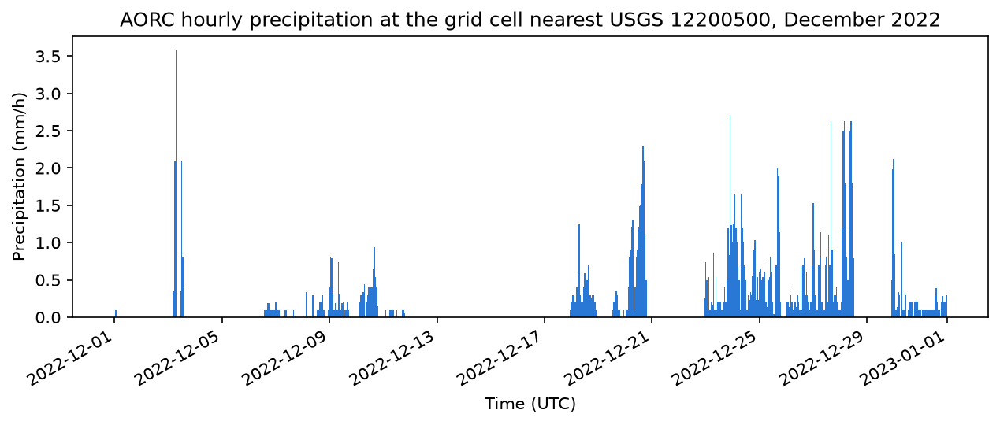

## Today's agenda {.smaller}

| Time (ET) | Minutes | Topic |
|---|---|---|
| 2:00 | 3 | Agenda, pre-reading recap |
| 2:03 | 7 | Module 4 overview |
| 2:10 | 20 | Comparative overview of the three products |
| 2:30 | 20 | Case study: linking locations; USGS |
| 2:50 | 12 | **Live coding 1** |
| 3:02 | 5 | Break |
| 3:07 | 8 | Looking ahead: NOAA NWM |
| 3:15 | 15 | A view from above: NASA SWOT |
| 3:30 | 12 | **Live coding 2** |
| 3:42 | 13 | Conclusions; additional data |
| 3:55 | 5 | Recap, questions |

::: notes
- The case study keeps its storyline order: USGS, then NOAA, then NASA.
- Two notebook switches today.
:::

## From the pre-reading

- **The event:** an atmospheric river drove the Skagit River near Mount Vernon, WA, past its 1990 record crest on **12 December 2025**.
- **The tools:** one Module 4 environment, `m04-synthesis`, reusing the Module 3 access patterns.
- **The credentials:** your USGS API key (`API_USGS_PAT`) and Earthdata Login, both in environment variables.

::: notes
- Recap of `session-06_module-04_federal-water-data-synthesis_pre-reading.pdf`.
- If you stored the USGS key with `conda env config vars set` in Session 5, repeat that in `m04-synthesis`.
:::

# Module 4 overview {background-color="#1f4e79"}

::: notes
- Section divider: Module 4 overview.
:::

## Each agency fills a niche

- Hydrologic systems are complex; several Federal agencies each fill an important niche.
- This module: the **strengths and limits** of each product, and using them **together** for a more robust hydrologic picture.

**Learning objective:** compare and describe the capabilities and limitations of NASA SWOT, NOAA NWM and USGS WDFN data for a single flood event at the appropriate scales and resolutions.

::: notes
- Sub-objectives: compare coverage, timing, accuracy and quality information; link one river location across agencies; line up observations, forecasts and satellite data; explain what each product can and can't show during a flood.
:::

## Synthesis: key ideas

- **Synthesis:** independent sources together, so each covers another's gaps, and agreement or disagreement tells you how confident to be.
- **Remote sensing vs. model vs. observation:** different kinds of error; complementary, not interchangeable.
- **Crosswalking locations** (SWORD reach ↔ COMID ↔ gage) is often the first and most error-prone step.
- **Common units and references:** convert units; compare **changes** when vertical references differ.

::: notes
- Reproducible synthesis multiplies what you record: SWOT product version, NWM model version, USGS approval status, your query and access dates.
- Data provider recommendations keep analyses defensible.
:::

# Comparative overview {background-color="#1f4e79"}

::: notes
- Section divider: Comparative overview.
:::

## Spatial coverage

- **NASA SWOT:** remotely sensed water extent; the RiverSP product maps it to ~10 km **SWORD reaches**, globally, on rivers roughly **50–100 m wide and wider**.
- **NOAA NWM:** every reach in the NHDPlus network (**2.7 million+**), gaged or not, including headwater streams.
- **USGS WDFN:** **discrete points** with sensors in the stream, from intermittent streams to the mouth of the Mississippi.

::: notes
- NWM's spatial completeness is its main strength, but use caution in ungaged, heavily regulated or poorly calibrated basins.
- Some USGS sites are in coastal zones where tides affect streamflow.
:::

## Temporal availability

- **NASA SWOT:** only when the satellite passes over; one record **per overpass**. The lowest Skagit reaches were seen **4–5 times** in December 2025. Since 2023.
- **NOAA NWM:** continuous: analysis, short range (18 h, hourly), medium range (8.5–10 days, 4×/day), long range (30 days). Forecasts since 2016; retrospective since 1979.
- **USGS WDFN:** near real time, provisional, typically every **15 minutes**; daily records back to 1889 at the oldest sites.

::: notes
- The NOAA NWM API keeps only the last 3–5 days; NOMADS keeps 48 hours. December 2025 forecasts come from the Google Cloud and AWS archives.
- At USGS 12200500, continuous discharge starts in 1988.
- In-situ sensors face equipment failures, critters and biofouling: gaps happen.
:::

## Accuracy: in each agency's own terms

- **NASA SWOT:** per-observation uncertainty (`wse_u`) and quality flags. ~10 cm is a **mission-level target**. On the lower Skagit, 14 of 18 December reach observations were **degraded**, none good.
- **NOAA NWM:** **no per-value flag**; depends on configuration, forcing, calibration and version. Skill falls with lead time.
- **USGS WDFN:** the usual reference, but discharge is **computed from gage height** with a rating curve. Peak discharges are usually **more uncertain** than typical flows.

::: notes
- Some NWM analysis configurations assimilate USGS and USACE observations.
- At 12200500, the 12 Dec measurement of 111,000 ft³/s, ~9 hours after the crest, was rated "Fair" vs. "Good" for a calmer November one.
- Values are provisional until approved.
:::

## Side by side: the shared concepts {.smaller}

| | NASA SWOT (RiverSP) | NOAA NWM | USGS WDFN |
|---|---|---|---|
| Location | `reach_id` (SWORD) | `feature_id` (COMID) | `USGS-12200500` |
| Variable | WSE, width, slope, area | Streamflow | Discharge, gage height |
| Unit | m, m/km | m³/s | ft³/s, ft |
| Time | Overpass (UTC) | Reference + valid (UTC) | 15-min or daily |
| Quality | `reach_q`, `wse_u` | None per value | `approval_status` |
| Version | Product version, DOI | Model version, configuration | Service, retrieval date |
| Data unit | Granule | One file per time step | One series per site + parameter |

::: notes
- The version row is the one most often left out of a methods section, and the one that most affects reproducibility.
:::

## Side by side: coverage and cautions {.smaller}

| | NASA SWOT | NOAA NWM | USGS WDFN |
|---|---|---|---|
| Space | Global rivers ~50–100 m+ | Every NHDPlus reach | ~9,000 gages |
| Time | Days to 21 days, since 2023 | Hourly; since 2016 (forecasts), 1979 (retro.) | 15-min; daily to 1889 |
| Latency | Days | ~1–2 hours | Minutes to hours |
| Strength | Rivers anywhere; floodplains | Complete network; forecasts | Best local record |
| Caution | Sparse in time | Model error; no flag | Points; ratings at extremes |

::: notes
- Sources: the agency material from Sessions 2–5 and NOAA OWP.
:::

## Which product for which question? {.smaller}

| If your question needs... | Start with |
|---|---|
| WSE, width or slope along a river, including ungaged rivers | NASA SWOT RiverSP |
| Where the water was on a given day | NASA SWOT Raster |
| Streamflow on an ungaged reach, or a long simulated record | NOAA NWM retrospective |
| What was expected to happen, or how forecasts changed with lead time | NOAA NWM forecasts |
| The best record of flow or stage at a site | USGS WDFN continuous and daily values |
| How much to trust a flood peak | USGS WDFN field measurements, with the rating |

Most real questions need more than one row.

::: notes
- A starting point, not agency guidance; check each agency's recommendations (next slide).
:::

## Agency recommendations

- **NASA:** use `earthaccess` and `hydrocron`; know your product version and don't mix versions; use the quality flags and uncertainties; request a `hydrocron` key for heavy use.
- **NOAA:** treat NWM output as **guidance, not the official forecast**; expect formats to change between versions; cite product and access date.
- **USGS:** check whether data are **provisional**; use the modernized Water Data APIs; get a free API key; cite with year, access date and DOI.

::: notes
- Each recommendation is drafted from agency sources, linked in the post-reading.
- NWM "complements official NWS river forecasts at approximately 4000 locations" (NOAA OWP).
- USGS: provisional information "is subject to revision". The legacy NWISWeb and WaterServices final decommission campaign runs November 2026 to February 2027.
:::

# Case study: the December 2025 Skagit River flood {background-color="#1f4e79"}

::: notes
- Section divider: Case study: the December 2025 Skagit River flood.
:::

## The event

).](https://svs.gsfc.nasa.gov/vis/a000000/a005500/a005596/PacificNorthwestFlooding_Dec2025_1920x1080.png){fig-alt="Map of the North Pacific from Japan to North America. Water vapor is shaded from blue (dry) to yellow (moist); a labeled 'Atmospheric River' band of moist air stretches from the tropics to the coast of Washington and British Columbia. An inset along the coast shades precipitation totals, heaviest (red) over British Columbia and western Washington." .r-stretch}

::: notes
- A long-lasting Category 5 atmospheric river brought heavy precipitation to the Pacific Northwest.
- On 12 December 2025, the Skagit near Mount Vernon passed its 1990 record crest (stage) (NOAA gauge MVEW1).
- Floods impact real people: evacuation orders affected more than 75,000 people in Skagit County (Northwest Public Broadcasting).
- The idea came from the PO.DAAC Hydrocron tutorial by Nikki Tebaldi, Cassandra Nickles and Brandi Downs.
:::

## One river, three location identifiers {.smaller}

| Agency (product) | Location identifier | What it represents |
|---|---|---|
| USGS (WDFN) | `USGS-12200500` | A single gage on the riverbank |
| NOAA (NWM) | COMID `24270288` | One NHDPlus stream segment |
| NASA (SWOT RiverSP) | SWORD reach `78310800031` | A ~10 km SWORD reach |

Start from the **gage**: its location is surveyed and fixed. The **NLDI** gives the COMID; the SWORD reach comes from comparing reach centerlines.

::: notes
- The story follows the order you'd meet the flood: gage, then forecasts, then satellite.
- NOAA's own MVEW1 page lists the same NWM reach: a useful cross-check.
- SWORD reach IDs came from the PO.DAAC Hydrocron Skagit tutorial; `…031`'s centerline passes within a few tens of meters of the gage.
:::

## Put the query in one place

```python
site = "USGS-12200500"                                     # Skagit near Mount Vernon
usgs_window = "2025-12-01T00:00:00Z/2025-12-31T23:59:59Z"  # continuous, UTC
daily_window = "2025-12-01/2025-12-31"                     # daily (local days)
measurement_window = "2025-11-01/2026-01-31"               # field measurements
nwm_issue_times = [("20251211", "00"), ("20251211", "12"), ("20251211", "18")]
sword_reaches = ["78310800041", "78310800031", "78310800021", "78310800015"]
swot_window = ("2025-11-01T00:00:00Z", "2026-01-15T00:00:00Z")   # RiverSP (UTC)
raster_window = ("2025-11-25", "2025-12-20")                     # Raster search
raster_short_name = "SWOT_L2_HR_Raster_100m_D"
```

Save a copy of these values with your results.

::: notes
- `sword_reaches` are the lowest four SWORD reaches, upstream to downstream.
- A few event-specific details (the 1 December baseline, the Raster tile, the floodplain box) stay in later blocks; the checklist for adapting to another river is in the post-reading.
:::

## The study area

{fig-alt="Map of the lower Skagit River in Washington State from Mount Vernon to Skagit Bay. A gray line traces the river main stem from the NHDPlus network, and the Washington shoreline is drawn in the upper left. Four thick colored lines mark the four lowest SWOT SWORD reaches, from reach 78310800041 above Mount Vernon to reach 78310800015 at the river mouth. A short dashed black line marks the NWM reach, COMID 24270288, and a black triangle marks the USGS gage 12200500, which sits on SWORD reach 78310800031." .r-stretch}

::: notes
- A point, one NHDPlus segment and a ~10 km SWOT reach all describe "the Skagit at Mount Vernon".
- The gage's datum is 3.8 ft NAVD88; SWOT WSE is above a global geoid. The lesson sidesteps datum conversion by comparing changes (VDatum is one way to convert).
:::

## On the ground: USGS observations

```python
discharge, _ = waterdata.get_continuous(monitoring_location_id=site,
                                        parameter_code="00060", time=usgs_window)
stage, _ = waterdata.get_continuous(monitoring_location_id=site,
                                    parameter_code="00065", time=usgs_window)
peak_q = discharge.loc[discharge["value"].idxmax()]
peak_h = stage.loc[stage["value"].idxmax()]
```

- Peak: **133,000 ft³/s at 08:00 UTC on 12 December** (midnight local); gage height **37.73 ft**.
- A **record stage** (above 37.37 ft in 1990), but **not a record flow** (152,000 ft³/s in 1990).

::: notes
- A record stage without a record flow is a clue that the stage–flow relationship at this site isn't fixed.
- All December 2025 values were `Approved` with no qualifiers at access (2026-10-08).
:::

## The limits of out-of-bank flow

- USGS records **stage** and converts it to discharge with a **rating curve**.
- Highest flow measured in this flood: **111,000 ft³/s** (ADCP), ~9 hours after the crest, rated `Fair`.
- The 133,000 peak is **above any flow measured in this flood**: computed from stage, not measured.
- When a river spills over banks or levees, the rating can change, and water can **bypass the gage**.

::: notes
- Field measurements: `time` holds the date and `time_of_day` the UTC time; join them to place a measurement on a timeline.
- Whether that part of the rating is supported by earlier floods is worth checking.
:::

## The USGS hydrograph

{fig-alt="Line chart of discharge at USGS gage 12200500, Skagit River near Mount Vernon, through December 2025. The 15-minute line rises from about 14,000 cubic feet per second in early December to a sharp crest of 133,000 on 12 December, falls, and rises again to a smaller peak around 17 December. Daily-mean steps follow the same shape but peak lower, at 112,000. A black dot marks the one December field measurement, 111,000 cubic feet per second, just after the crest." .r-stretch}

::: notes
- Daily mean for 12 December: 112,000 ft³/s. Daily values understate flood peaks.
- Daily values are local (Pacific) days; plotting at UTC midnight shifts them ~8 hours early.
:::

## Live coding 1: linking locations and USGS data {.smaller}

- **Notebook:** `module-04_lesson-02_synthesizing-federal-data-products.ipynb`
- **Sections:** "Defining the area of interest", then "Starting on the ground: observations from USGS"
- **Point out:**
  - the NLDI returns COMID `24270288` for the gage
  - the peak discharge and stage, and their `approval_status`
  - the field measurement table: compare 111,000 with the 133,000 peak
- **12 minutes.** Back at **3:02** for a break; slides resume at **3:07**.

::: notes
- If the study-area map cell is slow (Census download), skip it and show the slide.
- If short on time: run the query block, the COMID lookup and the peak cell only.
:::

## Break: 5 minutes {background-color="#1f4e79"}

::: notes
- Back at 3:07 pm ET.
:::

## Looking ahead: NOAA NWM forecasts

- What was **expected** to happen, on every NHDPlus reach. Short-range forecasts: every hour, 18 hours ahead.
- December 2025 is past the NOAA NWM API's window, so read the **cloud archive** with **kerchunk references** (~7× fewer bytes than `hydrotools`, no key).
- Three forecasts issued on **11 December at 00Z, 12Z and 18Z**; only the 18Z window reaches past the crest.

::: notes
- NOAA's MVEW1 page shows a different product: the official NWS river forecast from the Northwest River Forecast Center, not raw NWM output.
- Building references for all three took ~20 seconds (2026-10-08, home connection).
- Same `build_refs` and `open_refs` pattern as Session 4.
:::

## Pull the reach from each forecast

```python
forecasts = {}
for issued, r in refs.items():
    nwm = open_refs(r)
    nwm_version = nwm.attrs.get("NWM_version_number")   # provenance
    q = nwm["streamflow"].sel(feature_id=comid).load()
    forecasts[issued] = q.to_series() * 35.3147        # m³/s -> ft³/s
```

- One ~1.8 MB `streamflow` chunk per forecast hour, not the whole file.
- No per-value flag; record `NWM_version_number` (here `v3.0`).

::: notes
- Each entry is a pandas Series of 18 hourly values indexed by valid time (UTC).
- NWM valid times carry no time zone: label them UTC before plotting with USGS times.
:::

## A bigger flood, sooner {.smaller}

{fig-alt="Line chart from 10 to 13 December 2025 comparing observed discharge at USGS 12200500 (black) with three NWM short-range forecasts issued at 00Z, 12Z and 18Z on 11 December. The observed line rises to a crest of 133,000 cubic feet per second early on 12 December. Each forecast line rises faster and peaks higher, between 142,000 and 160,000, several hours before the observed crest." .r-stretch}

| Issued (UTC) | Forecast peak (ft³/s) | At (UTC) | USGS observed then |
|---|---|---|---|
| 11 Dec 00Z | 142,000 | 11 Dec 16:00 | 87,500 |
| 11 Dec 12Z | 160,000 | 12 Dec 00:00 | 116,000 |
| 11 Dec 18Z | 154,000 | 12 Dec 04:00 | 127,000 |

::: notes
- Observed crest: 133,000 ft³/s at 08:00 UTC on 12 December.
- Two cautions before "the model was 20% wrong": the observed peak is itself extrapolated beyond measured flows, and an NWM value is for a whole reach, not a point.
- What the forecasts gave, many hours ahead, was a consistent signal of an exceptional flood.
:::

## A view from above: NASA SWOT

- First question: **which passes saw the river during the flood?**
- **RiverSP** (via `hydrocron`): *how high was the river?*
- **Raster 100 m** (via `earthaccess`): *where was the water?*
- Both **Version D**, each with its own DOI: RiverSP [10.5067/SWOT-RIVERSP-D](https://doi.org/10.5067/SWOT-RIVERSP-D), Raster [10.5067/SWOT-RASTER-D](https://doi.org/10.5067/SWOT-RASTER-D).

::: notes
- Version D replaced Version C in 2025; some reach IDs and values differ, so record the version.
:::

## Which passes to trust? {.smaller}

- **`reach_q`:** 0 good · 1 suspect ("may have large errors") · 2 degraded ("very likely do have large errors") · 3 bad
- **`reach_q_b`:** bit flag recording *why*, e.g. `few_wse_observations` (2048), `partially_observed` (32768)
- **`wse_u`:** total WSE uncertainty (m)

December: **18** valid reach-passes, **4 suspect, 14 degraded**, none good. `reach_q` ≤ 1 keeps 4, and **no passes at the gage's reach**. So keep `reach_q` ≤ 2, then **check** the degraded values.

::: notes
- Definitions: RiverSP product description, JPL D-56413 Rev C (§4.1.7, p. 28; bits on pp. 60–61).
- `value & bit` is nonzero when that problem is present; any bit ≥ 262144 makes the pass at least degraded.
- WSE is in meters above the EGM2008 geoid.
:::

## Flags point to the doubtful passes

- On **4 December**, the gage's reach reads **12 m higher** than on 1 December while the gage was at baseflow. Its `reach_q` is 2, like most passes.
- `few_wse_observations` is set **only on the 4 and 25 December passes**; the gage reach's `wse_u` was **0.66 m** and 0.32 m (typical: ~0.1 m).
- **`wse_u` and `reach_q_b` give the reason; the gage confirms it.**

::: notes
- All 14 degraded passes carry `classification_qual_degraded`, 11 also `geolocation_qual_degraded`: common along this stretch, so they don't single out bad values.
- The decoding code is in the notebook.
:::

## Compare changes, not raw values

{fig-alt="Chart of water-level change since 1 December 2025, in meters. A black line shows the USGS gage rising about 7 meters to a peak on 12 December, then falling with a second smaller rise. Colored points with error bars show SWOT reach changes on five passes. On 12 December two downstream reaches show rises of about 6 and 3 meters. On 4 December the gage's own reach sits about 12 meters above zero while the gage line is near zero, and on 25 December two reaches sit about 2 meters above the gage line." .r-stretch}

::: notes
- Near the peak: gage +7.2 m; SWOT `…021` +6.0 m, `…015` (river mouth) +3.1 m: the rise shrinks toward the bay, where the tide sets the level.
- 22 Dec: `…031` and `…021` agree with the gage within ~0.2 m. 25 Dec: ~2 m high (the `few_wse_observations` passes).
- `wse_u` is the product's own estimate; on degraded passes the real error can be far larger (4 Dec: ~12 m off with `wse_u` 0.66 m).
- On 12 December the gage's own reach (`…031`) has no data.
:::

## Water extent near the peak (Raster)

{fig-alt="Two side-by-side maps of SWOT water fraction over the Skagit delta west of Mount Vernon, on 1 December 2025 (before the flood) and 12 December 2025 at 09:00 UTC (near the peak). Dark blue cells are mostly water and white cells mostly land; grey cells were masked out because they were not good or suspect in both passes, and they cover about two thirds of the box. Axes are kilometers from the gage, which lies 2 km east of the box's right edge. Open water in the bays to the north and southwest and the river channels look nearly the same in both maps, with no broad new area of water on the farmland." .r-stretch}

::: notes
- The near-peak pass missed the gage: its swath edge is ~4 km west of Mount Vernon.
- In the delta it saw: ~5,800 cells wet in both, ~340 newly wet, ~450 newly dry; no broad sheet of new floodwater.
- Only ~9,300 of 27,000 cells were good or suspect in both passes. The 4 Dec scene shows striped false "water" that `water_area_qual` flags.
- Raster search false matches: keep only `UTM10U` granules (3 remain, ~70 MB each).
:::

## Live coding 2: forecasts and SWOT {.smaller}

- **Notebook:** `module-04_lesson-02_synthesizing-federal-data-products.ipynb`
- **Sections:** "Looking ahead: forecasts from NOAA NWM", then "River water surface elevation through the event (RiverSP)"
- **Point out:**
  - the model version printed with each forecast
  - the `reach_q` cross-tabulation: what a strict filter would remove
  - the 4 December row: large `wse_u` and `few_wse_observations`
- **12 minutes.** Back to slides at **3:42**.

::: notes
- Skip the Raster download in class (3 × ~70 MB, Earthdata Login needed); learners can run it later.
- If short on time: run the forecasts only, and show the SWOT figures from the slides.
:::

## Conclusions {.smaller}

- **USGS:** the most reliable, highest-frequency record **at a point**, and field measurements show how far the peak was extrapolated.
- **NOAA NWM:** many hours' warning of an exceptional flood; here **high and early** (142,000–160,000 vs. 133,000 ft³/s); every reach.
- **NASA SWOT:** a spatial view. Unflagged passes matched the gage; the gage's reach was **not observed at the peak**.
- Linking them takes deliberate work: three IDs, two vertical references, different time steps and flags. **Each fills gaps the others leave.**

::: notes
- Save derived results separately, with a provenance file: gage, approval status, NWM version, SWOT granules (code in the post-reading).
- Cite: USGS DOI 10.5066/F7P55KJN; each SWOT collection's DOI; NWM by product, model version and access date.
:::

# Additional Federal water data {background-color="#1f4e79"}

::: notes
- Section divider: Additional Federal water data.
:::

## SWOTViz: look before you code

- [SWOTViz](https://swotviz.cuahsi.io/): a CUAHSI web viewer for SWOT river and lake data (in development).
- Shows SWORD reaches and nodes, Prior Lake Database lakes, orbit tracks and pass counts.
- Plots a feature's time series from `hydrocron`, with downloads.
- A quick way to **find reach IDs and check coverage** before using the Module 3 code.

::: notes
- Source code: github.com/CUAHSI/SWOT-Data-Viewer (GPL-3.0).
:::

## SWOT discharge: SWORD of Science (SoS) {.smaller}

- **In development:** not yet recommended for research. Explore its structure; don't use SoS values as results or inputs until NASA marks them validated.
- Discharge estimated by the SWOT Discharge Algorithm Working Group (**DAWG**), running several algorithms over SWORD reaches.
- Version 3 (`SWOT_L4_HR_DAWG_SOS_DISCHARGE_V3`): **May 2023 – May 2025**, one NetCDF per continent (North America ~9 GB).
- It doesn't cover the December 2025 flood.

::: notes
- Found with `earthaccess` like other SWOT products.
- `unconstrained` = algorithms ran without gage data; "gauge-constrained" use historical gage records.
- `hydrocron` can return `sos_consensus_q`, but only from the Version C collection: don't mix with Version D.
- Cite by DOI 10.5067/SWOT-SOS-RD3. CUAHSI notebooks: "Visualizing SOS Discharge with Xarray" and "Compare Observed and SoS Discharge".
:::

## NOAA AORC precipitation

- **Analysis of Record for Calibration:** hourly, gridded precipitation and near-surface weather over CONUS, on the 1 km NWM grid.
- The forcing used to **calibrate the NWM** and drive its retrospective: the natural precipitation pairing for NWM streamflow.
- Cloud-optimized **Zarr** on AWS; no account or key. This copy covers **1979 – January 2023**.

```python
store = fsspec.get_mapper(
    "s3://noaa-nwm-retrospective-3-0-pds/CONUS/zarr/forcing/precip.zarr", anon=True)
aorc = xr.open_zarr(store)   # lazy: only metadata is read
```

::: notes
- `RAINRATE` is in mm/s (× 3,600 for mm/h). The grid is Lambert Conformal Conic: convert the gage location with `pyproj`.
- December 2022 at the cell nearest 12200500: 744 hours, 151.1 mm total; about a minute from a laptop (each chunk is 28 days × 350 × 350 km).
- The full dataset is ~27 TB. For recent events, NOAA distributes AORC through other channels.
- Adapted from the CUAHSI notebook "Collecting and Manipulating AORC Data" (Castronova, Garousi-Nejad, Tijerina-Kreuzer, Bogan).
:::

## Hourly AORC precipitation, December 2022

{fig-alt="Bar chart of hourly precipitation through December 2022 at the AORC grid cell nearest the Skagit River gage near Mount Vernon. Most hours are dry or under 1 millimeter per hour; rain falls in several multi-day storms, with the largest hourly values a few millimeters per hour." .r-stretch}

::: notes
- The month isn't tied to a flood; it demonstrates access. To study a hydrograph's cause, pick a high-flow event inside 1979 – January 2023.
- Version and provenance are in the path (`noaa-nwm-retrospective-3-0-pds`): record it.
:::

## Other agencies

- The **U.S. Department of Agriculture (USDA)** and the **U.S. Army Corps of Engineers (USACE)** also publish water data that can complement these products.
- The **Environmental Protection Agency (EPA)** also produces or uses water data.

::: notes
- Ask learners which USDA, USACE or EPA water data they already use.
:::

# Wrap-up {background-color="#1f4e79"}

::: notes
- Section divider: Wrap-up.
:::

## Recap

- **Each product answers a different question:** USGS what happened at a point, NWM what was expected everywhere, SWOT how high and where from above.
- **Link first, then compare:** gage ID ↔ COMID ↔ SWORD reach; compare **changes** across vertical references.
- **Let flags and measurements set your confidence:** extrapolated peaks, model guidance and degraded passes all need checking.

::: notes
- One takeaway in the chat.
:::

## What's due and what's next

- **Module 4 quiz:** see Canvas.
- **Post-reading:** `session-06_module-04_federal-water-data-synthesis_post-reading.pdf` (adapting the case study to another river, saving derived data, the full agency recommendations, more on SoS and AORC).
- **Tue Dec 1:** peer review. **Thu Dec 3:** demos. Details on Canvas.

::: notes
- The adapting checklist in the post-reading is a good starting point for learners' own projects.
:::

## Questions?

::: notes
- About 5 minutes.
- Expect: "So which product is 'right' about the peak?" None alone: the gage is extrapolated above measured flows, the NWM is a reach-average model, and SWOT missed the gage's reach at the peak. Agreement across them is what builds confidence.
:::
